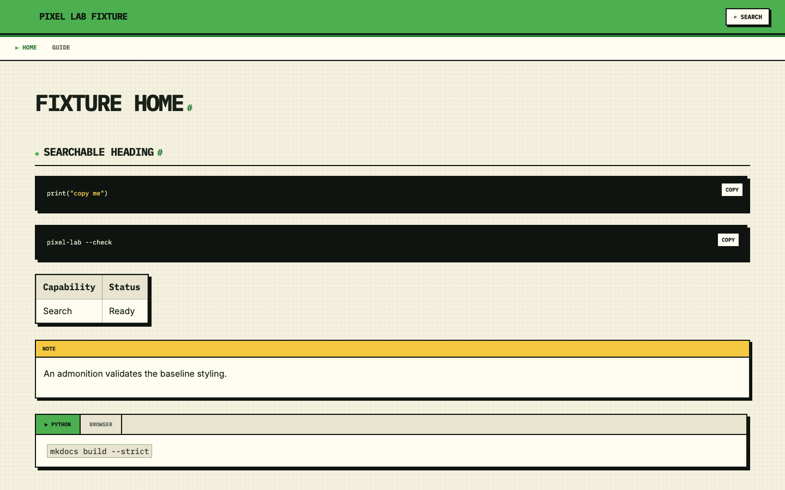
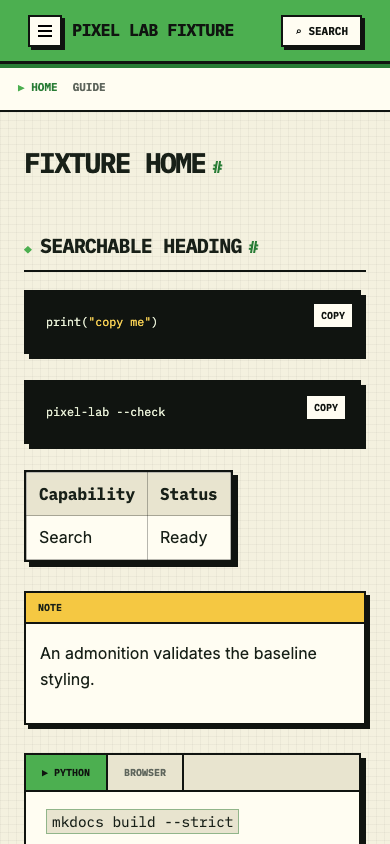

<p align="center">
  
</p>

<p align="center">
  <a href="https://pypi.org/project/mkdocs-pixel-lab/"></a>
  <a href="https://pypi.org/project/mkdocs-pixel-lab/"></a>
  <a href="https://github.com/trained-by-humans/mkdocs-pixel-lab/blob/main/LICENSE"></a>
  <a href="https://www.mkdocs.org/"></a>
</p>

<p align="center">
  A retro-inspired theme for <a href="https://www.mkdocs.org/">MkDocs</a>, with pixel borders, bold colors, and arcade-style shadows.<br>
  Built for modern documentation with responsive navigation, search, and rich Markdown components.
</p>

## Preview

<table>
  <tr>
    <td align="center"></td>
    <td align="center"></td>
  </tr>
  <tr>
    <td align="center">Desktop</td>
    <td align="center">Mobile</td>
  </tr>
</table>

## Demo

Visit [Pixel Lab on GitHub Pages](https://trained-by-humans.github.io/mkdocs-pixel-lab/)
to see the theme in action. The documentation site uses Pixel Lab itself and
includes examples of its components.

## Features

- A tastefully designed, retro-inspired theme with pixel-art assets, crisp borders, and playful shadows.
- Optional metadata, Git-based sitemap dates, and `robots.txt` plugins.
- Opt-in Google Analytics 4 with consent controls.

## Quick start

For an existing MkDocs project, install Pixel Lab:

```bash
python -m pip install mkdocs-pixel-lab
```

Select it in your existing `mkdocs.yml`:

```yaml
theme:
  name: pixel-lab
```

Preview your site:

```bash
mkdocs serve
```

Requires Python 3.10 or newer. Installing Pixel Lab also installs MkDocs,
Pymdown Extensions, and Pygments.

Starting a new project? Follow [Get started](docs/getting-started.md) for
environment setup, a new site, and enabling Markdown extensions.

## Expandable content layouts

Expandable `<details>` and `pymdownx.details` blocks automatically show a single
code block or table flush with the body frame. Prose, multiple blocks, and mixed
content keep a padded inset. Code retains its internal padding and scrolling.

Use `class="details-padded"` or `class="details-flush"` on a native `<details>`
element, or on a surrounding `<div markdown="1">` for `???` Markdown blocks.
The closest override wins; nested details and tabs select their layouts
independently. Explicit overrides work without JavaScript. Automatic layout
selection requires JavaScript; without it, unspecified layouts stay padded.
Native mouse and keyboard toggling works in either case.

See [Collapsible content](docs/components/details.md#layout-modes) for examples.

## Documentation

- [Theme setup](docs/setup/index.md): colors, fonts, icons, branding, navigation, search, repository links, and analytics.
- [Components](docs/components/index.md): Markdown syntax, live examples, required extensions, and appearance settings.
- [Reference](docs/reference/configuration.md): configuration defaults, [bundled plugins](docs/reference/plugins.md), [compatibility](docs/reference/compatibility.md), and [troubleshooting](docs/reference/troubleshooting.md).
- [Upgrading](docs/reference/upgrading.md): migration notes and checks for existing sites.
