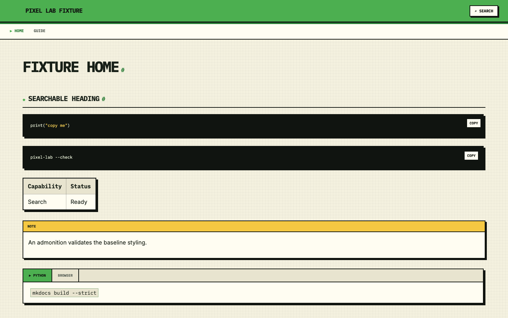
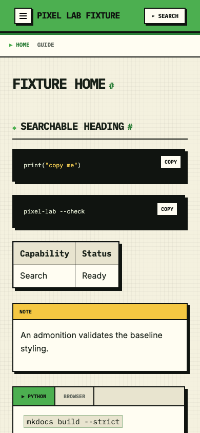

<p align="center">
  
</p>

<p align="center">
  <a href="https://pypi.org/project/mkdocs-pixel-lab/"></a>
  <a href="https://pypi.org/project/mkdocs-pixel-lab/"></a>
  <a href="https://github.com/trained-by-humans/mkdocs-pixel-lab/blob/main/LICENSE"></a>
  <a href="https://www.mkdocs.org/"></a>
</p>

<p align="center">
  A retro-inspired theme for <a href="https://www.mkdocs.org/">MkDocs</a>, with pixel borders, bold colors, and arcade-style shadows.<br>
  Built for modern documentation with responsive navigation, search, and rich Markdown components.
</p>

## Preview

<table>
  <tr>
    <td align="center"></td>
    <td align="center"></td>
  </tr>
  <tr>
    <td align="center">Desktop</td>
    <td align="center">Mobile</td>
  </tr>
</table>

## Quick start

```bash
python -m pip install mkdocs-pixel-lab
```

Use it in `mkdocs.yml`:

```yaml
theme:
  name: pixel-lab
```

The snippets below show settings to merge into your existing `mkdocs.yml`.

## Everyday features

### Responsive navigation

Primary navigation tabs and the contextual section sidebar follow MkDocs'
`nav:` tree. Narrow browser windows use a menu drawer with the same links,
whether viewed on a phone or desktop. The current page and section are marked
automatically.

### Search

The toolbar search opens a compact panel backed by MkDocs' search index.
Enable the standard plugin:

```yaml
plugins:
  - search
```

Toolbar actions appear in the order **Packages → Search → Repository**, with
optional actions omitted when not configured. At 850px and below, the toolbar
switches to icon-only buttons alongside the navigation toggle. Accessible
labels and tooltips remain available. The site
name stays on one line and truncates with an ellipsis only if space runs out.
This responsive layout works without JavaScript.

### Repository button

Set MkDocs' `repo_url` to show a repository button in the toolbar:

```yaml
repo_url: https://github.com/OWNER/REPO
```

The button opens that URL directly and uses `repo_name` as its label (MkDocs
normally infers GitHub, GitLab, or Bitbucket), falling back to **Repository**.
It has a pixelated Git branch icon and the same hover/focus highlight, shadow,
and lift as the other toolbar buttons. On small screens, only the icon is shown,
with its accessible label and tooltip preserved. It works without JavaScript.

`show_repo` is enabled by default. Hide the button without affecting page
source/edit actions:

```yaml
theme:
  name: pixel-lab
  show_repo: false
```

The repository button is independent of `edit_uri`, `show_source`, and
`show_edit`. An absolute edit URL without `repo_url` does not enable it.

#### Custom repository icon

Customize the icon with `theme.icon.repo`, using Material's configuration
structure:

```yaml
theme:
  name: pixel-lab
  icon:
    repo: assets/icons/my-repo.svg
```

Place this file at `docs/assets/icons/my-repo.svg`. Paths are relative to
`docs_dir` and resolved correctly on nested pages. Full HTTPS URLs and raster
images such as PNG also work. Pixel Lab uses image paths, not Material's bundled
icon names (such as `fontawesome/brands/github`).

Custom artwork preserves its original colors and fits in the same 14×14 slot,
without an extra border, background, or shadow. Button hover, keyboard focus,
and mobile behavior remain unchanged. Omit `icon.repo` or set it to `null`
to keep the theme-colored pixelated Git branch icon.

### Custom UI icons

Toolbar and page-action icons share the `theme.icon` settings:

```yaml
theme:
  name: pixel-lab
  icon:
    repo: assets/icons/repo.svg
    search: assets/icons/search.svg
    menu: assets/icons/menu.svg
    close: assets/icons/close.svg
    sites: assets/icons/packages.svg
    dropdown: assets/icons/chevron.svg
    view: assets/icons/source.svg
    edit: assets/icons/edit.svg
```

All values are image paths relative to `docs_dir` or image URLs, not Material
icon-library names. SVG is recommended; PNG and other browser-supported image
formats also work. Omit any key, or set it to `null`, to keep its current default.
Icons do not enable features: `show_repo`, `show_source`, `show_edit`, and site
navigation settings still control availability.

| Key | Control |
| --- | --- |
| `repo` | Repository toolbar button |
| `search` | Search toolbar button |
| `menu` / `close` | Open / close the mobile navigation drawer |
| `sites` | Packages/site-navigation toolbar button |
| `dropdown` | Its dropdown arrow; still hidden on compact screens |
| `view` / `edit` | View source / Edit this page beside the main title |

Toolbar images keep their original colors and fit the existing 14×14 slots.
Page source and edit images are **alpha masks**: transparent areas
stay empty, and opaque areas receive the theme's foreground and copied hover
shadow. Use transparent artwork; an opaque white background becomes a solid
square. Remote mask images must allow cross-origin loading (CORS).

Custom page-action icons use a black silhouette and accent-dark hover/focus
shadow. Custom icons work without JavaScript. Heading permalinks use a single
built-in icon or the symbol supplied through [`toc`](#heading-links-and-keyboard-access),
not `theme.icon`.

Dropdown item artwork continues to use each item's `icon` and `icon_hover`
under `extra.site_navigation`; these settings do not change item icons, active
navigation markers, or the site-name/TM branding.

### Page source

GitHub-backed sites show a pixelated **View source** icon immediately after the
main page title, with no box or background. Like heading anchors, it scales
with the title and reveals an accent-dark shadow on hover or keyboard focus.
The icon has an accessible label and hover tooltip. Set MkDocs'
repository URL and the branch/directory containing your Markdown files:

```yaml
repo_url: https://github.com/OWNER/REPO
edit_uri: edit/main/docs/
```

For `docs/guide/setup.md`, the link opens GitHub's `blob/main/docs/guide/setup.md`
file view. Set the branch and directory explicitly; MkDocs' GitHub default is
`edit/master/docs/`. The theme converts the resolved GitHub editor URL to its
file view for View source, while the Edit this page icon keeps the editor URL.

The link is enabled by default when available. Hide it with:

```yaml
theme:
  name: pixel-lab
  show_source: false
```

The theme uses MkDocs' `page.edit_url`, honoring `edit_uri_template` and source
mappings provided by generators. No plugin, Git checkout, or GitHub API request
is needed. The link is present in built HTML and remains usable with JavaScript
disabled; the theme's script appends it to the authored H1 without changing
the heading's text or ID. Generated pages without a source mapping have no
source link. Set `edit_uri: ""` to disable source links entirely (also remove
`edit_uri_template` if configured). File-view URLs are inferred only for
standard `github.com` URLs; other hosts do not display a source link.

#### Edit action

Like MkDocs' built-in themes, Pixel Lab shows an edit action whenever MkDocs
provides `page.edit_url`. A pixelated pen-nib icon appears beside the
source icon; no opt-in theme setting is required:

```yaml
repo_url: https://github.com/OWNER/REPO
edit_uri: edit/main/docs/
theme:
  name: pixel-lab
```

`show_edit` is enabled by default and independent of `show_source`. Hide only
the edit icon with:

```yaml
theme:
  name: pixel-lab
  show_edit: false
```

To disable MkDocs' edit URLs instead, set `edit_uri: ""` and remove any
`edit_uri_template`. This also removes the inferred View source link.

The edit icon uses the same title-relative sizing, transparent background, hover shadow,
and keyboard focus styling as the source icon. Its accessible label and tooltip
are **Edit this page**.

The edit link uses MkDocs' resolved `page.edit_url` unchanged, including
non-GitHub repositories, custom `edit_uri_template` URLs, and generator source
mappings. Use your provider's editor path (`edit/main/docs/` for GitHub), not a
file-view path such as `blob/main/docs/`, when enabling editing. Missing or
disabled edit URLs omit the icon. No additional plugin or API request is needed.

### Heading links and keyboard access

Section headings (H2–H6) show a permalink icon after the title. H1 page titles
keep their IDs without a heading-permalink icon; the optional source icon is
separate.

Permalinks are generated by Python-Markdown's `toc` extension, not a MkDocs
plugin. Its settings are preserved: `permalink: false` (or omitting the option)
produces no links, `permalink: true` uses the theme's solid pixelated link icon,
and a custom string such as `permalink: "⚓"` displays that symbol as text.
`permalink_title`, `permalink_leading`, and heading ID settings remain under
`toc`'s control.

The built-in icon scales with the heading and uses a black silhouette with a
matching accent-dark shadow on hover or keyboard focus. It works without
JavaScript. There are no separate theme settings for permalink artwork or fill;
use `toc` to enable, disable, or customize heading links.

The URL fragment follows the current section as you scroll, without adding
browser-history entries. Enable visible heading permalinks with:

```yaml
theme:
  name: pixel-lab
markdown_extensions:
  - toc:
      permalink: true
```

For a custom symbol and tooltip, configure the extension directly:

```yaml
markdown_extensions:
  - toc:
      permalink: "⚓"
      permalink_title: "Link to this section"
      permalink_leading: false
```

A skip-to-content link, visible focus styles, and labeled navigation regions
support keyboard use. Escape closes the search panel or open navigation drawer
and returns focus to its toolbar button.

### Media, tables, and nested shadows

Images and videos scale to the available content width. Wide tables scroll
inside a fixed bordered frame, keeping its pixel shadow in place. When cards,
alerts, tables, media, or code are nested inside an elevated component, inner
shadows are removed automatically so only the outer component is elevated.

### Bundled fonts

Inter and IBM Plex Mono are served with the theme. No Google Fonts request or
external font service is required.

## Rich Markdown content

### Code blocks

Syntax-highlighted code blocks include a one-click copy button with success
and failure feedback. Enable Pymdown's fenced-code and highlighting extensions:

```yaml
markdown_extensions:
  - pymdownx.superfences
  - pymdownx.highlight
```

Code and inline-code colors follow the theme palette; long blocks scroll
horizontally.

Pygments is installed with the theme, so syntax coloring works in clean build
environments. Emphasize individual lines with `hl_lines`:

````markdown
```{ .python hl_lines="2" }
import math
print(math.pi)
```
````

### GitHub Alerts

Enable GitHub-style Markdown alerts explicitly when a site uses them:

```yaml
markdown_extensions:
  - mkdocs_pixel_lab.github_alerts
```

The extension supports `NOTE`, `TIP`, `IMPORTANT`, `WARNING`, and `CAUTION`:

```markdown
> [!TIP]
>
> Use semantic callouts for important guidance.
```

### Content tabs and collapsible notes

Admonitions, expandable details, and content tabs use the same pixel borders
and palette as the rest of the theme. Enable the corresponding extensions:

```yaml
markdown_extensions:
  - admonition
  - pymdownx.details
  - pymdownx.tabbed:
      alternate_style: true
```

Content tabs are separate from the primary navigation tabs below the toolbar.

Each content tab automatically chooses its layout: a single code block or
table fills the panel **flush**, while prose, multiple blocks, and mixed
content retain the **padded** layout. Code keeps its internal padding, tables
keep their cell padding and horizontal scrolling, and the tab container owns
the outer border and shadow. Nested tabs are evaluated independently.

To force a layout, wrap a tab group in `.tabs-padded` or `.tabs-flush` and
enable `md_in_html` in `markdown_extensions`:

````markdown
<div class="tabs-padded" markdown="1">

=== "Python"

    ```python
    print("Keep the surrounding inset")
    ```

=== "Shell"

    ```bash
    echo "This tab is padded too"
    ```

</div>
````

Use `.tabs-flush` instead to remove the surrounding inset. The closest
layout wrapper wins for nested groups. Layout detection runs in the theme's
script; with JavaScript disabled, tabs retain the padded presentation.

## Page metadata

Define browser/search titles and descriptions using standard Markdown front
matter. Visible headings and explicitly configured navigation labels stay
unchanged:

```markdown
---
title: Detect and Annotate with Supervision
description: Load predictions and annotate images with boxes, labels, and masks.
---

# Detect and Annotate
```

The theme honors these fields without another plugin. To also generate
defaults for pages without metadata, enable the build-time plugin bundled
with Pixel Lab (no additional package is needed):

```yaml
plugins:
  - search
  - pixel-lab/metadata
```

Titles use `title` → first H1 → MkDocs page title → site name. The site name
is appended once. Descriptions use `description` → first introductory
paragraph → `site_description`, and the tag is omitted if none is available.
Blank or non-text front-matter fields are ignored by the plugin.

Generated excerpts retain plain text, including inline code and link text,
but skip code blocks, tables, alerts, lists, images, and navigation. They are
shortened at a word boundary to at most 160 characters, including an ellipsis;
explicit descriptions are not shortened. Extraction runs during the build,
so metadata is in the HTML without JavaScript. It does not edit Markdown
files or replace MkDocs' canonical URLs. Google may choose a different search
title or snippet.
This plugin does not use Git or change sitemap modification dates.

## Sitemap modification dates

The optional `pixel-lab/git-lastmod` plugin sets sitemap `lastmod` to the
date of each Markdown source file's last committed Git change, rather than
the build date. MkDocs continues to generate `sitemap.xml` and `sitemap.xml.gz` using
your `site_url`; no separate sitemap generator is required.

Enable this separately bundled plugin in `mkdocs.yml` (no additional package
is needed):

```yaml
plugins:
  - search
  - pixel-lab/git-lastmod
```

It is independent of `pixel-lab/metadata`: enable either plugin or both.
Without `pixel-lab/git-lastmod`, the theme preserves MkDocs' default sitemap
dates and does not run Git commands.

Git must be installed and the documentation repository must have complete
history. For GitHub Actions documentation builds, use:

```yaml
- uses: actions/checkout@v4
  with:
    fetch-depth: 0
```

An unrelated commit or rebuild does not change a page's date. Dates use the
last commit's committer date; local uncommitted edits and front-matter display
dates do not override Git history. Untracked or generated pages, files
outside the documentation repository, missing Git history, and shallow
clones omit `lastmod` instead of falling back to today's date. Renamed files
use their Git history. Dates are cached within each build and refreshed on
the next rebuild.

## Robots.txt

Enable the optional `pixel-lab/robots` plugin to generate a public-crawling
default at `robots.txt` in the built site:

```yaml
site_url: https://example.com/
plugins:
  - search
  - pixel-lab/robots
```

The generated file allows crawling and points to MkDocs' sitemap:

```text
User-agent: *
Allow: /

Sitemap: https://example.com/sitemap.xml
```

The sitemap URL comes from `site_url`, including any deployment path. If
`site_url` is not set, the sitemap directive is omitted. This plugin is
independent of metadata and Git dates and does not require Git or another
package. Without it, the theme does not generate `robots.txt`.

To customize crawl rules, add your own `docs/robots.txt`; an existing file
always takes priority and is copied unchanged. The published file is static:
page additions and edits do not require changing it. Update it when crawl
rules or the domain/sitemap location changes; the generated default follows
`site_url` automatically on rebuild.

Crawlers only consult `robots.txt` at the domain root. For sites hosted under
a path such as `example.com/project/`, the generated project file must be
published or incorporated at `example.com/robots.txt` by the hosting owner.
Robots rules are not access control and do not guarantee removal from search
results; protect private content through authentication.

## Customize your site

### Palette

Every theme color is configured from the single `theme:` block in `mkdocs.yml`.
The default palette preserves Pixel Lab’s original appearance; override only
the tokens your site needs:

```yaml
theme:
  name: pixel-lab

  # Brand
  header_background: "#8315F9"
  accent_color: "#8315F9"
  accent_dark_color: "#5E0AAE"
  accent_foreground_color: "#FFFFFF"

  # Neutrals used by every component
  background_color: "#f4f1df"
  surface_color: "#fffdf2"
  surface_alt_color: "#e8e4cf"
  text_color: "#182018"
  muted_text_color: "#5f665d"
  border_color: "#101410"
  shadow_color: "#101410"
```

`header_background` accepts any CSS background value, including a linear
gradient. All other options accept any valid CSS color, including `rgba()` and
CSS variables.

<details>
<summary>Palette token reference</summary>

| Tokens | Used for |
| --- | --- |
| `background_color`, `surface_color`, `surface_alt_color` | Page, cards, input, and table surfaces. |
| `text_color`, `strong_text_color`, `muted_text_color` | Body, control, and secondary text. |
| `border_color`, `shadow_color`, `subtle_border_color`, `sidebar_border_color` | Component outlines, offset shadows, table rules, and navigation dividers. |
| `grid_color`, `overlay_color` | Page grid and mobile-navigation scrim. |
| `header_background`, `header_border_color`, `header_shadow_color`, `accent_color`, `accent_dark_color`, `accent_foreground_color` | Header, links, navigation, active states, and accent-filled controls. |
| `highlight_color`, `secondary_color`, `input_focus_background_color`, `inline_code_border_color`, `tab_hover_color` | Interactive controls, badges, inline code, and hover states. |
| `code_background_color`, `code_text_color`, `code_keyword_color`, `code_string_color`, `code_function_color`, `code_comment_color` | Code block and syntax-highlight colors. |
| `alert_note_color`, `alert_note_surface_color`, `alert_tip_color`, `alert_tip_surface_color`, `alert_important_color`, `alert_important_surface_color`, `alert_warning_color`, `alert_warning_surface_color`, `alert_caution_color`, `alert_caution_surface_color` | GitHub Alert rails, titles, and surfaces. |

</details>

This separation lets a site change its border and shadow independently without
having to maintain CSS overrides or edit the theme.

The analytics acceptance button uses `header_background` and
`accent_foreground_color`, matching the header background and site title
without separate color settings.

### Favicon

Pixel Lab includes a default favicon. Override it for a site-specific mark:

```yaml
theme:
  name: pixel-lab
  favicon: assets/favicon.svg
```

The custom path is relative to your documentation directory. SVG and PNG
favicons are supported.

### Footer and branding

The site title includes a decorative pixel TM badge. Its circle and letter
fill follow the title's text color; the glyph's outer and inner borders use
the light and dark theme accents. Add a short footer message with
`theme.footer_text`; the built-in Pixel
Lab and Trained-by-Humans attribution remains below any related-site links:

```yaml
theme:
  name: pixel-lab
  footer_text: Build something useful
```

## Site navigation

Choose either inline links beside the site title or a dropdown beside Search,
with an independent footer lane. All reuse `extra.site_navigation`; the dropdown
shows every item, followed by the optional catalog link, without lane size limits.

<details>
<summary>Site navigation configuration</summary>

```yaml
extra:
  site_navigation:
    header_mode: dropdown # dropdown | inline | none
    show_footer: true
    dropdown_label: Packages # defaults to Sites
    header_size: 4 # includes the catalog link
    footer_size: 7 # includes the catalog link
    footer_label: Packages
    items:
      - title: Core
        url: https://ml-pipes.com/
        icon: assets/core.svg
      - title: Supervision
        url: https://supervision.ml-pipes.com/
        active: true
        icon: assets/supervision.svg
        icon_hover: assets/supervision.svg#icon-hover
      - title: Vision
        url: https://github.com/trained-by-humans/ml-pipes/tree/main/packages/vision
    catalog:
      title: All Packages →
      url: https://ml-pipes.com/packages/
```

</details>

Omit `site_navigation` to render no related-site navigation. When configured,
`header_mode` selects one toolbar presentation: `dropdown` (the default), `inline`,
or `none`. Use it in place of the previous `show_header` / `show_dropdown` flags;
the two toolbar presentations never render together. `show_footer` independently
controls the footer lane and defaults to `true`.

Inline header and footer lanes require a catalog link. The inline header renders
up to `header_size` links and the footer up to `footer_size`; each capacity includes
the catalog link. These sizes do not limit the dropdown. On narrow screens, the
inline header hides and the footer links stack vertically.

Set each item's optional `icon` to an SVG/PNG path relative to the documentation
directory or an absolute URL. Missing icons use a themed pixel fallback; icons
appear only in the dropdown. The catalog can also specify an icon. The dropdown
works without a catalog and marks the configured active item. Mouse hover previews
the menu; moving into it keeps the preview open, while leaving closes it. Click
the button to pin it open. A second mouse click returns to the hover preview;
touch and keyboard activation toggle it open or closed. Pinned Packages and
active Search take priority over the other button's hover preview.
Use Tab or arrow keys to navigate, and Escape to close it. Clicking outside also closes it.
On small screens, the header buttons use icons while keeping accessible labels.

Optionally set `icon_hover` to an animated image URL. It replaces the resting
`icon` on pointer hover or keyboard focus, restarts on each entry, and restores
the static icon on exit or when the dropdown closes. Reduced-motion users retain
the static icon. Hover images are fetched once and replayed from cached data;
use a same-origin asset or an external URL that allows CORS. An SVG can use a
fragment such as `#icon-hover` to activate its own `:target` animation, letting
the same file supply both static and animated artwork. Hover-enabled icons have
a 24 × 44 px image slot, including the row's vertical spacing. Add that breathing
room inside both SVG canvases so the animation stays within the viewBox without
shrinking the resting artwork. Missing or failed hover images leave the resting
icon unchanged. Without `icon_hover`, icons stay static in a 24 × 24 px slot.

## Analytics and privacy

### Google Analytics 4

Analytics is off by default. Configure a GA4 Measurement ID (`G-…`, not a
Firebase API key or Google Tag Manager ID) and your privacy-notice URL to
enable the built-in opt-in prompt:

```yaml
site_url: https://ml-pipes.com/
theme:
  name: pixel-lab
extra:
  analytics:
    provider: google
    measurement_id: G-XXXXXXXXXX
    privacy_policy: https://ml-pipes.com/privacy/
```

The prompt appears automatically on the first HTTPS visit matching `site_url`.
**Allow analytics** loads the Google tag; **Decline** does not. Choices can be
changed through **Analytics settings** in the footer. Withdrawal disables
collection, attempts to clear the site's GA cookies, and reloads the page.
Set `enabled: false` under `analytics` to turn the integration off. Google is
currently the only supported analytics provider.

<details>
<summary>Google setup and data-handling notes</summary>

Missing or invalid Measurement IDs leave tracking off. Local development and
alternate-host previews do not collect visits. When browser storage is blocked,
a choice applies only to the current page. Advertising consent remains denied;
Google Signals and advertising personalization are disabled. Initial page URLs
and referrers omit query strings and fragments.

To configure a GA4 property:

1. In [Google Analytics](https://analytics.google.com/), create a GA4 property
   and a **Web** data stream for your production site.
2. Copy its Measurement ID. Related documentation sites can share an ID;
   distinguish them in reports by **Hostname**. The theme keeps GA cookies
   hostname-specific, so user counts are not deduplicated across subdomains.
3. In **Enhanced measurement → Page views → Advanced settings**, disable page
   changes based on browser history events. Heading-fragment updates are not
   separate page visits. Review the other automatic measurements you enable.
4. Publish a privacy notice and configure its URL. Review applicable consent
   requirements; this prompt is not a certification of legal compliance. Do
   not send personal information through events or page titles.
5. Deploy and verify acceptance in **Realtime**. Test denial in a fresh browser
   context; Google requests should be absent.

The Measurement ID is public, not a secret. No API key, Firebase SDK, GitHub
secret, or separate subdomain property is required. Reports describe consenting
visitors, not every visit or an individual's identity.

References: [Google tag setup](https://developers.google.com/tag-platform/gtagjs)
and [consent implementation](https://developers.google.com/tag-platform/security/guides/consent).

</details>

### Privacy links

`extra.analytics.privacy_policy` is required: a missing, empty, or whitespace-only
URL keeps analytics off. The same link appears in the consent prompt and
footer, alongside **Analytics settings** when tracking is enabled. Retaining
the URL with `enabled: false` keeps the policy link visible. Relative URLs such
as `privacy/` work from nested pages.

Publish a notice customized to your operator and data practices; Pixel Lab
does not supply a universal privacy policy. Related sites may link to one
shared notice that explicitly covers them.

### Consent across sites

By default, consent is stored per documentation site URL and Measurement ID,
including separate project paths on the same GitHub Pages hostname. To share
acceptance and rejection across a custom domain and its subdomains, configure
the same `consent_domain` and Measurement ID on every participating site:

```yaml
extra:
  analytics:
    provider: google
    measurement_id: G-XXXXXXXXXX
    consent_domain: ml-pipes.com
    privacy_policy: https://ml-pipes.com/privacy/
```

Both acceptance and rejection are shared through a consent-only cookie scoped
to that domain, with `Secure`, `SameSite=Lax`, `Path=/`, and a 180-day lifetime.
The prompt identifies the shared domain. Use this only for sites you control
under the same privacy policy, not public suffixes or shared hosting domains
such as `github.io`. Other open sites synchronize changes on focus and
periodically. Only consent is shared; GA cookies remain hostname-specific.

Unrelated or malformed domains disable analytics, and browsers reject
public-suffix cookies. No parent domain is inferred automatically. Changing
the consent scope requires a new choice; previous site-only choices are not
silently promoted to domain-wide permission.
