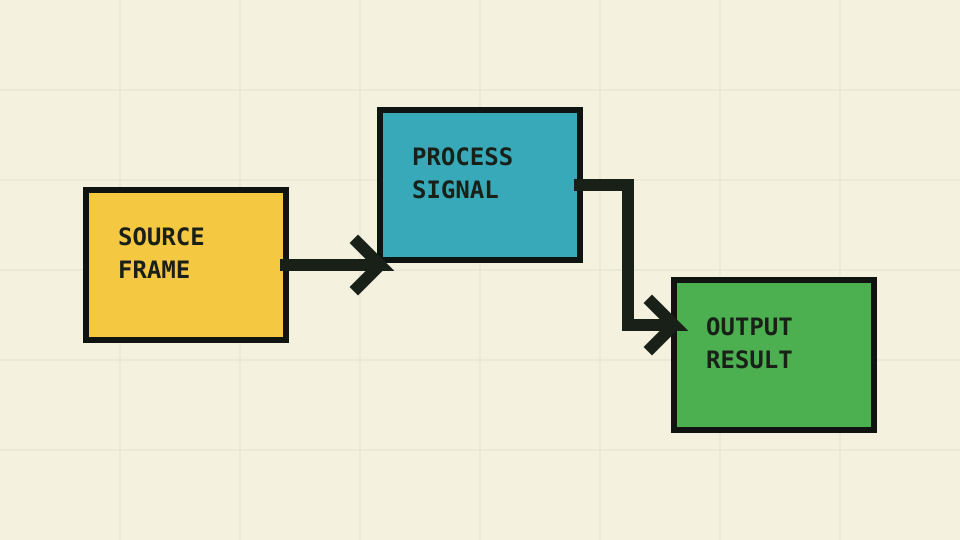

# Card grids

Use grids to arrange related content in responsive columns. Add cards for
section indexes, landing pages, and collections of next steps.

## Enable

```yaml
markdown_extensions:
  - attr_list
  - md_in_html
```

For highlighted code inside cards, also enable [Code blocks](code-blocks.md#enable).

## List cards

Wrap a Markdown list in a `grid cards` container. Each list item becomes a
card; indent paragraphs and links to keep them inside the same item.

<div class="grid cards" markdown="1">

- **Get up and running**

    Install Pixel Lab, create your first page, and preview your documentation.

    [Start building →](../getting-started.md)

- **Make it yours**

    Choose the colors, fonts, and branding that fit your project.

    [Explore theme setup →](../setup/index.md)

- **Find your way**

    Organize pages into sections and help readers discover what comes next.

    [Set up navigation →](../setup/navigation.md)

- **Show your work**

    Share examples with highlighted code, line emphasis, and a copy button.

    [Explore code blocks →](code-blocks.md)

- **Explain the details**

    Keep tips, warnings, and supporting information close to the content.

    [Explore admonitions →](admonitions.md)

- **Bring pages to life**

    Add responsive images and video with the theme's pixel borders.

    [Explore media →](media.md)

</div>

```markdown
<div class="grid cards" markdown="1">

- **Get up and running**

    Install the theme and create your first page.

    [Start building →](../getting-started.md)

- **Make it yours**

    Choose the colors, fonts, and branding that fit your project.

    [Explore theme setup →](../setup/index.md)

</div>
```

Links remain ordinary links: use Tab to reach them and Enter to open them.
On hover, cards lift while their shadow's outer edges stay anchored. With
reduced motion enabled, only the border color changes.

## Rich content

Cards can hold illustrations, prose, links, and code. Each card below is an
explicit block inside the same grid.

<div class="grid" markdown="1">

<div class="card" markdown="1">

### A visual explanation



Walk readers through a workflow with an illustration and a short explanation.

[Add images and video →](media.md)

</div>

<div class="card" markdown="1">

### A practical example

Start with a small configuration and add more as your documentation grows.

```yaml
site_name: My project
theme:
  name: pixel-lab
```

[Read the getting started guide →](../getting-started.md)

</div>

</div>

Use an explicit `.card` wrapper when one card contains several blocks:

````markdown
<div class="grid" markdown="1">

<div class="card" markdown="1">

### A practical example

Start with a small configuration.

```yaml
site_name: My project
theme:
  name: pixel-lab
```

[Read the getting started guide →](../getting-started.md)

</div>

</div>
````

## Simple block cards

Short blocks can also become cards, without a surrounding list.

<div class="grid" markdown="1">

**Keyboard friendly.** Follow ordinary links with Tab and open them with Enter.
{ .card }

**Responsive by default.** Cards form columns when space allows and stack on
smaller screens.
{ .card }

</div>

```markdown
<div class="grid" markdown="1">

**Keyboard friendly.** Follow ordinary links with Tab and open them with Enter.
{ .card }

**Responsive by default.** Cards stack when the available space is narrow.
{ .card }

</div>
```

## A grid without cards

A generic grid can arrange content without adding borders, surfaces, or shadows.

<div class="grid" markdown="1">

<div markdown="1">

### For readers

Browse clear examples, follow related topics, and find the next useful step.

[Browse components →](index.md)

</div>

<div markdown="1">

### For authors

Write with Markdown and combine existing components to suit your content.

[Read the configuration reference →](../reference/configuration.md)

</div>

</div>

```markdown
<div class="grid" markdown="1">

<div markdown="1">

### For readers

Browse examples and discover related topics.

</div>

<div markdown="1">

### For authors

Write with Markdown and combine existing components.

</div>

</div>
```

## Customization

Cards use the theme's shared surface, border, shadow, and accent colors:

```yaml
theme:
  name: pixel-lab
  surface_color: "#fffdf2"
  border_color: "#101410"
  shadow_color: "#101410"
  accent_color: "#4caf50"
```

| Parameter | Default | Effect |
| --- | --- | --- |
| `surface_color` | Ivory · `#fffdf2` | Card background |
| `border_color` | Near-black · `#101410` | Card outlines |
| `shadow_color` | Near-black · `#101410` | Card shadows |
| `accent_color` | Leaf green · `#4caf50` | Card border on hover |

See [Common attributes](../reference/configuration.md#common-attributes).

### Component-wide overrides

The grid provides gaps between items, and cards provide padding around their
content. To adjust these independently, add rules to your
[custom stylesheet](index.md#load-custom-css):

```css
.grid {
  gap: 1.25rem;
}

.card,
.grid.cards > :is(ul, ol) > li {
  padding: 1.25rem;
}
```

### Scoped overrides

Wrap a selected grid, following [Scope selected instances](index.md#scope-selected-instances):

```markdown
<div class="instance-card-grid" markdown="1">

<div class="grid cards" markdown="1">

- **First topic**

    A short introduction.

- **Second topic**

    Another useful starting point.

</div>

</div>
```

Add the scoped rules to your stylesheet:

```css
.instance-card-grid {
  padding: 20px;
}

.instance-card-grid > .grid {
  gap: 1.5rem;
}
```

Space around a grid can come from its container's padding or the grid's own
margins. Choose the surrounding space to suit the page; a grid can also sit
directly in the content column without a wrapper.
