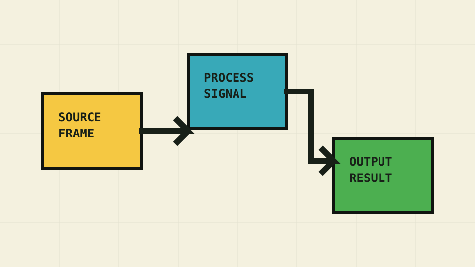

# Images and video

Content images and videos scale to the available width and receive Pixel Lab's
border and offset shadow.

Smaller media keep their natural size. Standalone Markdown images can use the
full content column, while ordinary prose keeps its narrower reading width.

## Images



```markdown

```

Image paths are relative to the Markdown file. This example lives in
`docs/components/`, and its asset is in `docs/assets/`. Write useful alternative
text rather than repeating a filename.

## Video

Use HTML for a video with playback controls. For example, after adding
`docs/assets/demo.mp4`, a page in `docs/components/` can contain:

```html
<video controls preload="metadata" aria-label="Product demonstration">
  <source src="../../assets/demo.mp4" type="video/mp4">
  Your browser doesn't support embedded video.
</video>
```

Supply captions for spoken content and avoid autoplay. Paths in raw HTML
aren't rewritten like Markdown image paths: this example uses the path from
the built page at `/components/media/` with MkDocs' default directory URLs.
Adjust it if your page depth or URL layout differs.

## Customization

These theme settings customize all content media:

```yaml
theme:
  name: pixel-lab
  surface_color: "#fffdf2"
  border_color: "#101410"
  shadow_color: "#101410"
```

| Parameter | Default | Effect |
| --- | --- | --- |
| `surface_color` | Ivory · `#fffdf2` | Background behind transparent images and video |
| `border_color` | Near-black · `#101410` | Image and video frames |
| `shadow_color` | Near-black · `#101410` | Offset pixel shadows |

See [Common attributes](../reference/configuration.md#common-attributes).

### Component-wide overrides

To change every content image and video's frame color, add this to your
[custom stylesheet](index.md#load-custom-css):

```css
.main img,
.main video {
  border-color: #101410; /* Near-black */
}
```

### Scoped overrides

Wrap the selected media, following [Scope selected instances](index.md#scope-selected-instances):

```markdown
<div class="instance-media" markdown="1">


</div>
```

Add the scoped rule to your stylesheet:

```css
.instance-media img {
  border-color: #101410; /* Near-black */
}
```
