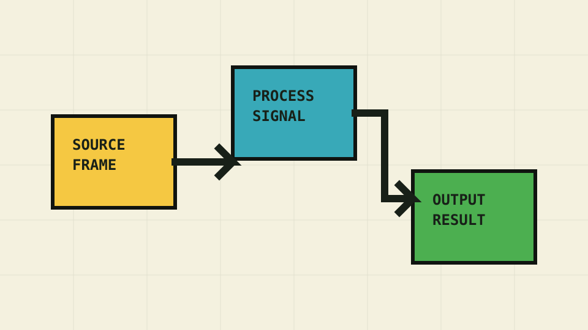

# Images and video

Content images and videos scale to the available width and receive Pixel Lab's
border and offset shadow.

Smaller media keep their natural size. Standalone Markdown images can use the
full content column, while ordinary prose keeps its narrower reading width.

## Images



```markdown

```

Image paths are relative to the Markdown file. This example lives in
`docs/components/`, and its asset is in `docs/assets/`. Write useful alternative
text rather than repeating a filename.

## Video

Use HTML for a video with playback controls. For example, after adding
`docs/assets/demo.mp4`, a page in `docs/components/` can contain:

```html
<video controls preload="metadata" aria-label="Product demonstration">
  <source src="../../assets/demo.mp4" type="video/mp4">
  Your browser doesn't support embedded video.
</video>
```

Supply captions for spoken content and avoid autoplay. Paths in raw HTML
aren't rewritten like Markdown image paths: this example uses the path from
the built page at `/components/media/` with MkDocs' default directory URLs.
Adjust it if your page depth or URL layout differs.

## Customization

Use the properties and selectors below to customize this component, following the
[Customization](customization.md) guide.

### Component properties

These CSS variables take their default values from the corresponding theme settings.

| Property | Description | Theme setting | Default |
| --- | --- | --- | --- |
| `--surface` | Background behind transparent images and video | `surface_color` | Ivory · `#fffdf2` |
| `--border` | Image and video frames | `border_color` | Near-black · `#101410` |
| `--shadow` | Offset pixel shadows | `shadow_color` | Near-black · `#101410` |

See [Colors](../setup/colors.md) for palette configuration.

### Component styles

Use these selectors to style media in the page content.

| Selector | CSS properties | Description |
| --- | --- | --- |
| `.main img, .main video` | `background`, `border`, `box-shadow`, `margin`, `max-width` | Shared media surfaces, frames, shadows, spacing, and width limits |
| `.main img` | `width`, `height`, `object-fit` | Image dimensions and how the image fits an explicitly sized box |
| `.main video` | `width`, `height`, `object-fit` | Video dimensions and how the video fits an explicitly sized box |
